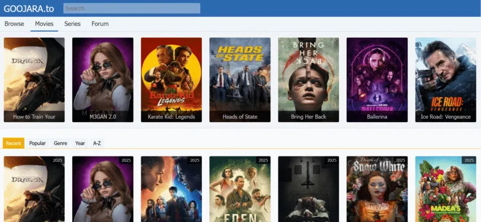

# Movie Platform

## 1. Sujet du projet

**Movie Platform** est une plateforme web dédiée à la découverte et à la consultation des films et des séries.

La plateforme permet aux utilisateurs de rechercher des films, consulter leurs informations et découvrir différents contenus selon leurs catégories.

Le projet comprend également une interface d'administration pour gérer les films, les séries et les catégories.

## 2. Objectif du projet

L'objectif principal de ce projet est de développer une plateforme web simple, moderne et facile à utiliser pour faciliter la découverte et la gestion des contenus cinématographiques.

Les objectifs spécifiques sont :

- Permettre aux utilisateurs de consulter les films et les séries.
- Faciliter la recherche des films par titre.
- Afficher les détails de chaque film.
- Organiser les contenus par catégories et genres.
- Permettre à l'administrateur de gérer les contenus.

## 3. Technologies utilisées

| Technologie | Utilisation |
|---|---|
| HTML | Structure des pages |
| JavaScript | Gestion des interactions |
| Tailwind CSS | Mise en forme de l'interface |
| Fetch API | Communication avec le backend |
| PHP | Traitement des données |
| JSON | Stockage des données |

## 4. Fonctionnalités principales

### Liste à puces

- Consultation des films.
- Recherche des films.
- Affichage des détails.
- Gestion des catégories.
- Administration des contenus.

### Liste numérotée

1. Accéder à la plateforme.
2. Consulter les films disponibles.
3. Rechercher un film.
4. Consulter les informations du film.

### Liste de tâches

- [x] Créer la structure HTML.
- [x] Préparer l'interface utilisateur.
- [ ] Développer les fonctionnalités JavaScript.
- [ ] Créer les API avec PHP.
- [ ] Tester les fonctionnalités.

## 5. Formatage du texte

Voici un exemple de texte en **gras**.

Voici un exemple de texte en *italique*.

Voici un exemple de texte ~~barré~~.

## 6. Lien du projet

[Visiter GitHub](https://github.com/ibrahim-Medkour/labs-mobile/tree/main/lab-markdown)

## 7. Image du projet



## 8. Code

Exemple d'affichage d'un message en JavaScript :

`console.log("Bienvenue sur Movie Platform");`

### Bloc de code

```javascript
const film = {
    titre: "Inception",
    annee: 2010,
    genre: "Science-fiction"
};

console.log(film);
```

## 9. Citation

> La technologie permet de transformer une idée en une solution pratique et accessible.

---

## 10. Conclusion

Ce projet représente une occasion de mettre en pratique les connaissances acquises en développement web, notamment en HTML, JavaScript, PHP et JSON.

Il permet également de développer des compétences en organisation, en programmation et en documentation technique.
